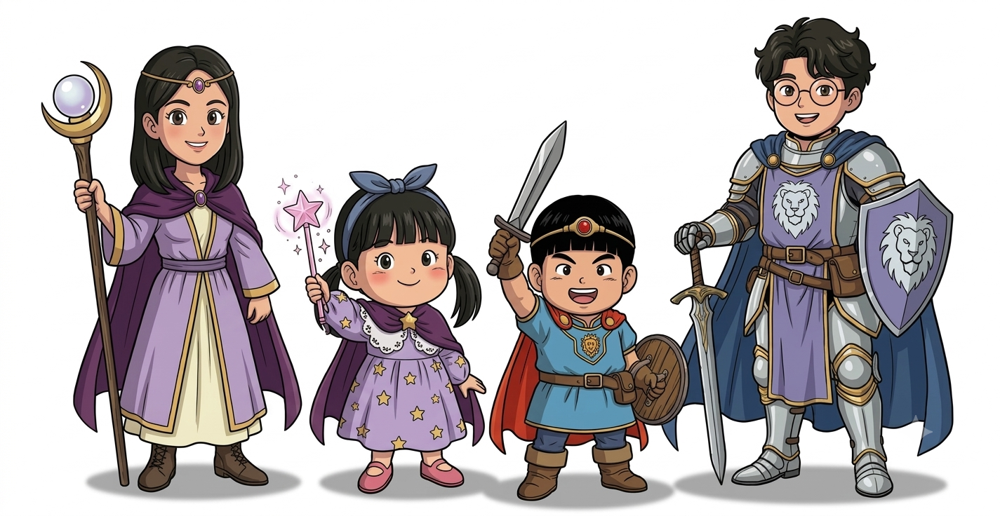

# 우리 가족 파티

| | 이름 | 직업 | 나이 | 역할 | 에셋 |
|---|---|---|---|---|---|
| ⭐ | **서진** | 마법사 | 7살 | **주인공**. 별 지팡이로 별빛 마법 | `assets/characters/gen/girl/` |
| ⭐ | **지훈** | 용사 | 3살 | 서진이 동생. 챕터 2 끝에 합류 | `assets/characters/gen/boy/` |
| ⭐ | **엄마** | 현자 | — | 치유·빛의 마법 | `assets/characters/gen/mom/` |
| ⭐ | **아빠** | 기사 | — | 사자 방패로 가족을 지킴 | `assets/characters/gen/dad/` |

## 서진 — 마법사, 주인공 ⭐
- 별빛 마을에 사는 꼬마 마법사. 킹 젤리가 훔쳐 간 밤하늘의 별빛을 되찾으러 떠나요.
- 겉모습: 일자 앞머리, 낮게 묶은 양갈래, 파란 데님 리본 머리띠, 연보라 원피스와 보라 망토, 분홍 별 지팡이
- 주문 (테스트 버전): 리본 파이어, 별빛 폭풍 ✏️
- 카드: "별빛" 카드 (girl_card)

## 지훈 — 용사 ⭐
- 서진이의 동생. 챕터 2 보스를 물리친 뒤 누나와 합류해 챕터 3부터 2인 파티 ⭐
- 겉모습: 바가지 머리, 빨간 보석 머리띠, 사자 문장 파란 튜닉, 작은 칼과 둥근 나무 방패
- 성격·주문: 공격형 용사, "번개" 카드 ✏️

## 엄마 — 현자 ⭐
- 겉모습: 어깨 길이 검은 머리, 금 머리띠, 연보라 로브와 보라 망토, 초승달 지팡이, 마법책
- 2026-09-27 서진이 피드백 "엄마가 나이 들어 보여" → 젊은 얼굴로 다시 그림 ⭐
- 카드: "엄마의 빛" (황금 치유의 빛)
- 합류 시점: 미정 → [open_questions.md](open_questions.md)

## 아빠 — 기사 ⭐
- 겉모습: 동그란 안경, 곱슬 검은 머리, 은빛 갑옷, 사자 문장 방패와 장검, 파란 망토
- 서진이 평가: "아빠 에셋은 멋지다" ⭐
- 카드: "아빠의 방패" (황금 사자 방어막)
- 합류 시점: 미정

## 그림 비율 규칙 (단체 그림)
- 아빠·엄마 약 5.5등신, 서진 약 4등신(엄마 가슴 높이), 지훈 약 3.5등신(누나 어깨 높이). 같은 그림체로 머리 모양·눈·선 굵기를 맞춰요.
- 기준 그림: `assets/characters/gen/family/family_party.png`
