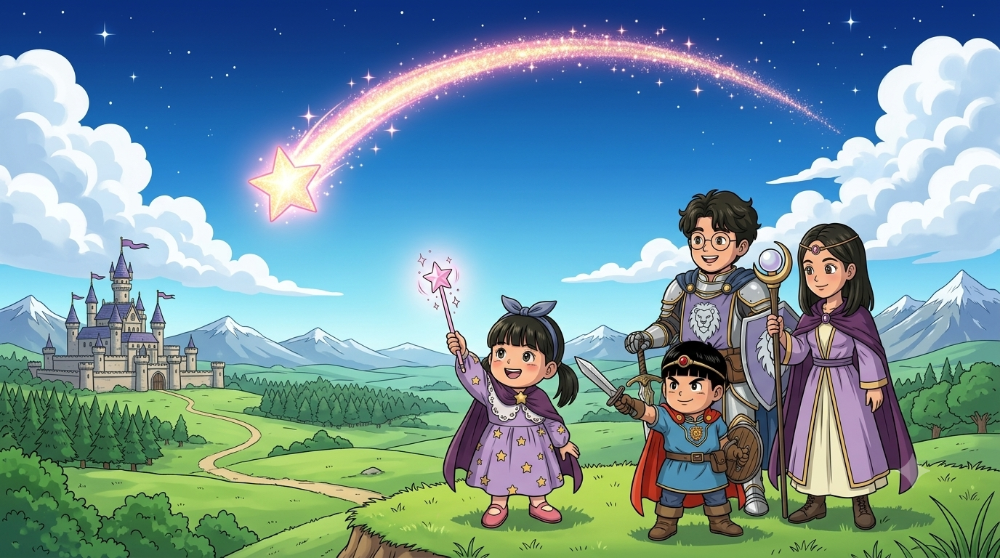

# 세계와 지역

## 세계의 규칙
- 이 세계에는 **젤리**들이 살아요. 착한 젤리(마을 사람)도 있고 나쁜 젤리(몬스터)도 있어요. ✏️ (테스트 버전 설정)
- **젤리 색 = 세기** ⭐: 파랑(쉬움) < 초록(중간) < 핑크(어려움)
- **젤리 단계** ⭐: 1단 → 2단(더 크고 셈) → 3단(왕관 = 킹 젤리). 킹 젤리보다 더더더 센 **이단 킹 젤리**도 있어요.
- 몬스터 머리 위에 그리는 막대기 = **체력바** ⭐ (그림에는 넣지 않고 게임 HP 막대로 표현)
- 성에서 가까울수록 쉽고, 멀어질수록 어려워요 ⭐ (노트 1의 난이도 지도)

## 지역
| 지역 | 설명 | 몬스터 | 게임(테스트) |
|---|---|---|---|
| **별빛 마을** | 서진이가 사는 마을. 착한 젤리들(촌장·여관 주인·밀짚모자·리본·꼬마 젤리), 가게, 여관, 우물 ✏️ | — | 있음 |
| **초원** | 마을 밖 들판, 풀숲에 젤리가 숨어 있음 | 파랑·초록·핑크 젤리, 큰 젤리 | 있음 |
| **킹 젤리의 성** | 초원 남동쪽. 킹 젤리가 별빛을 훔쳐 감 | 킹 젤리(3단) | 있음 |
| **동굴** | 돌·광물·수정이 있는 동굴 ⭐ | 돌멩이·광물·수정 젤리 (+호박 젤리) | 있음 |
| **적 기지** | 동굴 안, 열쇠로 여는 문 | 바위 대장 젤리, 젤리 장군 | 있음 |
| **사막 (마을)** | 챕터 3 무대 ⭐(사용자) | 카우보이 젤리, 선인장 젤리 ⭐ | 없음 |
| **숲** | ⭐ | 나무 젤리, 벌레 젤리 ⭐ | 없음 |
| **적의 성** | 칼·창이 있는 성 ⭐ | 군인 젤리 ⭐ | 없음 |
| **(미정) 눈 덮인 곳?** | 예티가 사는 곳? | 예티 ⭐ | 없음 — [open_questions.md](open_questions.md) |

자세한 몬스터는 [몬스터 도감](../monsters/README.md).

## 바뀐 기록
- 2026-09-27 시작
