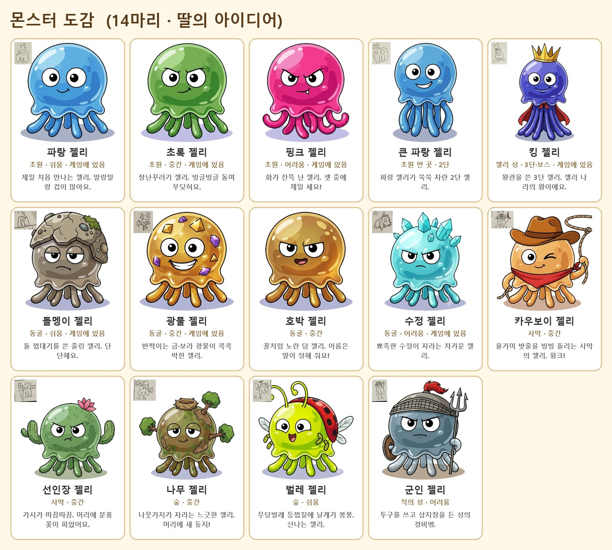

# 몬스터 도감 (미리 만들어 두는 몬스터 에셋)

딸이 계속 몬스터 아이디어를 내요. 떠오를 때마다 **그림을 먼저 만들어 도감에 넣어 두고**, 게임에 필요해지면 꺼내 써요.

## 파일
| 위치 | 내용 |
|---|---|
| `docs/monsters/monsters.json` | **도감 목록 (기준 파일)**: 이름·지역·난이도·한 줄 설명·원본 그림·딸 스케치·게임에 들어갔는지 |
| `docs/monsters/dogam.jpg` | 한눈에 보는 도감 (자동 생성) |
| `assets/monsters/gen/<지역>/` | Gemini 원본 그림 (여러 마리가 한 장에 있기도 함) |
| `assets/monsters/cut/<id>.png` | 한 마리씩 자른 투명 배경 PNG (자동 생성) — 게임에 넣을 때 이걸 씀 |
| `assets/monsters/sketches/` | 딸의 원래 스케치 조각 |

## 새 몬스터 추가하는 법
1. 딸의 노트를 `docs/ideas/daughter_note_NN.jpg` 로 저장하고, 몬스터 부분을 `assets/monsters/sketches/` 에 잘라 둠
2. Gemini (새 채팅, 이미지 만들기): **기준 그림 `assets/monsters/gen/jelly_blue/jelly_blue_v1.png`** + 딸 스케치를 붙여 넣고
   "Image 1 is our finished JRPG monster 'blue jelly' - keep EXACTLY this art style ... Image 2 is my 5-year-old daughter's drawing of ..." (지난 프롬프트는 이 문서 아래)
   - 2~3마리를 한 장에 "well separated with lots of white space", "plain pure white background" 로 뽑으면 한 번에 여러 마리
3. 원본을 `assets/monsters/gen/<지역>/` 에 넣고 `monsters.json` 의 `sheets`(줄마다 몇 마리)와 `monsters` 에 한 줄씩 추가
4. `python tools/monster_catalog.py` → 자르기 + 도감 이미지 갱신

## 게임에 넣을 때
- 지금 게임 전투의 젤리는 코드로 그린 그림(`Painter.Jelly`)이에요. 도감 그림으로 바꾸는 건 백로그 항목으로 진행해요.
- 이름을 `enemies.json` 과 맞추고 `ingame` 칸을 채워요.

## 지금까지 쓴 프롬프트 요지 (2026-09-27)
- 기준 파랑 젤리: 딸의 1단 젤리 스케치 + "Toriyama Dragon Quest monster art ... round translucent blue jelly head with big simple eyes and a wavy skirt of drippy tentacle legs ... plain pure white background"
- 나머지: 기준 그림 + 스케치, 색·소품·표정만 설명 (초록=장난꾸러기 눈썹, 핑크=화난 눈썹+송곳니, 킹=왕관+빨간 망토, 돌=돌 투구+이끼, 광물=금·보라 결정, 수정=수정 가시, 카우보이=모자+빨간 반다나+올가미, 선인장=선인장 팔+분홍 꽃, 나무=나뭇가지+새 둥지, 벌레=무당벌레 등껍질+더듬이+날개, 군인=철 투구+빨간 깃털+삼지창+나무 방패)
